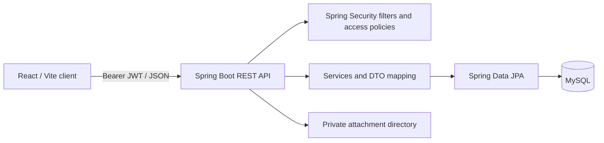

# BugTrack Pro — Professional Bug Tracking System

A full-stack Bug Tracking System built with **Spring Boot 3.5 + Java 21 + MySQL 8 + React 18 + Vite**. This release hardens and extends the supplied project, but it is **not approved for company purchase or production deployment** until the unverified items in [ACCEPTANCE_REPORT.md](ACCEPTANCE_REPORT.md) are completed.

The application has a React client, REST API, JPA persistence, JWT bearer authentication and a MySQL database. API access checks are enforced server-side; see [API.md](API.md) and [SECURITY_AUDIT.md](SECURITY_AUDIT.md).



The main persisted relationships are users to projects (manager and project-members join table), projects to bugs and sprints, bugs to reporter/assignee, comments, attachments and history, and users to notifications. Audit events store actor email as a value rather than a user foreign key.

## Existing feature inventory

1. Professional analytics dashboard — status/priority/severity/developer charts, critical and SLA metrics.
2. Advanced bug search and filters — text, project, status, priority and severity.
3. Professional bug details — reproduction steps, environment, ownership, SLA, sprint and metadata.
4. Full bug workflow — Open → In Progress → Resolved → Closed → Reopened.
5. Bug history/audit timeline — lifecycle changes, comments and attachments.
6. Comments and issue activity notifications.
7. Secure attachments — authenticated download, size and file-type validation.
8. Team management — enable/disable users and admin role management.
9. Project management — projects, managers and project health metrics.
10. Sprint management — create, start/complete, date windows and project grouping.
11. Drag-and-drop Kanban board — move issues across workflow states.
12. In-app notifications — unread count, toast alerts and read-all.
13. Optional email notifications — SMTP-ready assignment notifications.
14. SLA / overdue tracking — severity-based automatic deadlines and breach indicators.
15. BugTrack AI assistant — local heuristic triage for module, category, severity, priority and reproduction steps.
16. Duplicate bug detection — similarity matching against existing issues.
17. Developer workload analytics — assigned volume and average resolution metrics.
18. Reports and exports — CSV export plus browser Print/Save as PDF report workflow.
19. Light/dark mode — persistent UI preference.
20. Security center — JWT, RBAC, BCrypt, bounded expiring login throttling, password policy, attachment validation and audit events.

Implementation depth and outstanding work are tracked in [PROJECT_CHECKLIST.md](PROJECT_CHECKLIST.md); the list above is an inventory, not a claim that every workflow is fully verified.

## Technology

### Backend
- Java 21
- Spring Boot 3.5.6
- Spring Web
- Spring Data JPA / Hibernate
- Spring Security
- JWT (JJWT)
- MySQL Connector/J
- Bean Validation
- Optional Spring Mail
- Lombok

### Frontend
- React 18
- Vite
- React Router
- Axios
- Lucide React
- Responsive CSS

## Database

MySQL 8.x

Create the database/user using your own password (do not use a shared or default password):

```sql
CREATE DATABASE bugtracker;
CREATE USER 'bugtracker'@'localhost' IDENTIFIED BY 'replace-with-your-database-password';
GRANT ALL PRIVILEGES ON bugtracker.* TO 'bugtracker'@'localhost';
FLUSH PRIVILEGES;
```

## Run with Maven + local MySQL

Copy `.env.example` to `.env` and replace the database and bootstrap-account placeholders. For Docker Compose run `docker compose up --build`. For a local MySQL installation, the included backend launcher reads `.env` automatically.

### Backend

```bash
bash backend/run-local.sh
```

API: `http://localhost:8080`

### Frontend

Open another terminal:

```bash
cd frontend
npm ci
npm run dev
```

UI: `http://localhost:5173`

## Deploy to Railway

Follow [RAILWAY_DEPLOYMENT.md](RAILWAY_DEPLOYMENT.md) to deploy the frontend, API, and MySQL as separate Railway services. The guide covers service directories, environment variables, HTTPS domains, admin bootstrap, health checks, and persistent attachment storage.

This is a review/demo deployment path. It is not approved for production use with operational data until the outstanding database migration, security, and live acceptance work in [ACCEPTANCE_REPORT.md](ACCEPTANCE_REPORT.md) is completed.

## Initial administrator

The application does not create public demo accounts or ship default credentials. Configure `BOOTSTRAP_ADMIN_NAME`, `BOOTSTRAP_ADMIN_EMAIL`, and a unique `BOOTSTRAP_ADMIN_PASSWORD` of at least 12 characters in `.env`. At startup, it creates the account only when there is no active ADMIN; this does not delete or modify existing users. Remove the bootstrap variables after the admin account is created. Public registration creates a TESTER account. When launching without the provided script, export these variables in the same terminal before starting Spring Boot because Spring does not load `.env` files automatically.

In development, an unset JWT secret generates a temporary random key (tokens stop working after restart). In production, set `APP_ENV=production` and a unique `JWT_SECRET` containing at least 32 bytes.

The provided [backend launcher](backend/run-local.sh) loads `.env` for non-Docker startup. If starting Maven manually, export the settings in the same shell because Spring Boot does not load `.env` automatically. The bootstrap runs when there is no active ADMIN, so it can add the first admin without deleting a previously registered TESTER account.

## Optional email notifications

Email is disabled by default so the project works without SMTP configuration. To enable it, set:

```text
EMAIL_ENABLED=true
MAIL_HOST=smtp.example.com
MAIL_PORT=587
MAIL_USERNAME=...
MAIL_PASSWORD=...
MAIL_SMTP_AUTH=true
MAIL_SMTP_STARTTLS=true
```

## Security notes

- JWT access tokens are stateless; each request checks the current account status and role in MySQL.
- Passwords are BCrypt hashed.
- Role checks are enforced at the API layer.
- Login is limited to 10 attempts per client address and account each minute by default. Counters expire and the in-memory map is bounded; limits are not shared across API replicas. Set `MAX_LOGIN_ATTEMPTS`, `LOGIN_WINDOW_SECONDS`, and `MAX_TRACKED_LOGIN_IDENTITIES` to tune the single-instance demo.
- Registration requires a 12+ character password with uppercase and number.
- Attachments are limited to 10 MB and an allow-list of common safe project file types.
- JPA entities are converted to DTOs before JSON serialization to avoid Hibernate proxy leaks.
- `spring.jpa.open-in-view=false` is intentionally retained.
- Attachment files are private; downloads pass through an authenticated controller and ownership/access check.

## API and verification

- Endpoint reference: [API.md](API.md)
- Role and status workflow checklist: [PROJECT_CHECKLIST.md](PROJECT_CHECKLIST.md)
- Security findings: [SECURITY_AUDIT.md](SECURITY_AUDIT.md)
- Acceptance results and manual verification steps: [ACCEPTANCE_REPORT.md](ACCEPTANCE_REPORT.md)

Run backend tests from `backend/` with `mvn test`. Run the frontend build from `frontend/` with `npm ci && npm run build`. The automated backend suite currently covers ten JWT, request-filter, workflow, and access-policy unit cases; no frontend tests or DB-backed integration suite are included.

## AI note

The included AI assistant is intentionally **local and deterministic** so the project runs without an external AI API key. It provides explainable heuristic suggestions and duplicate similarity. An OpenAI/other LLM provider can be plugged into the same endpoint later if desired.


## Database startup and notifications

The backend includes `src/main/resources/schema.sql`, which creates the `notifications` table only if it is missing. Hibernate initializes entity tables first and deferred SQL initialization then applies this idempotent notification-table DDL. Existing user/project/bug tables are not dropped. The application uses Hibernate `ddl-auto=update`; this is suitable for local setup but is not a versioned production migration strategy.

Before starting, make sure the MySQL database exists and the configured database user has CREATE/ALTER/REFERENCES privileges. Configure credentials through `DB_USERNAME` and `DB_PASSWORD`; do not commit real passwords to source control. A live database was not available during this build review, so verify table creation against an isolated MySQL instance before migrating an existing deployment.

If the app logs other Hibernate DDL errors, inspect the *first* schema error before the notification warning; later foreign-key warnings can be secondary effects.

## Backup and restore

For a locally installed MySQL server, use the database account and host configured for this project. `mysqldump` prompts for the database password; keep the backup outside the source tree and protect it as sensitive data.

```bash
mysqldump --single-transaction -h localhost -u bugtracker -p bugtracker > bugtracker-backup.sql
mysql -h localhost -u bugtracker -p bugtracker < bugtracker-backup.sql
```

Back up the private attachment directory separately from MySQL. Test restores on a separate database before relying on the backup. Docker volume backup/restore commands depend on the host and are not verified in this release.
